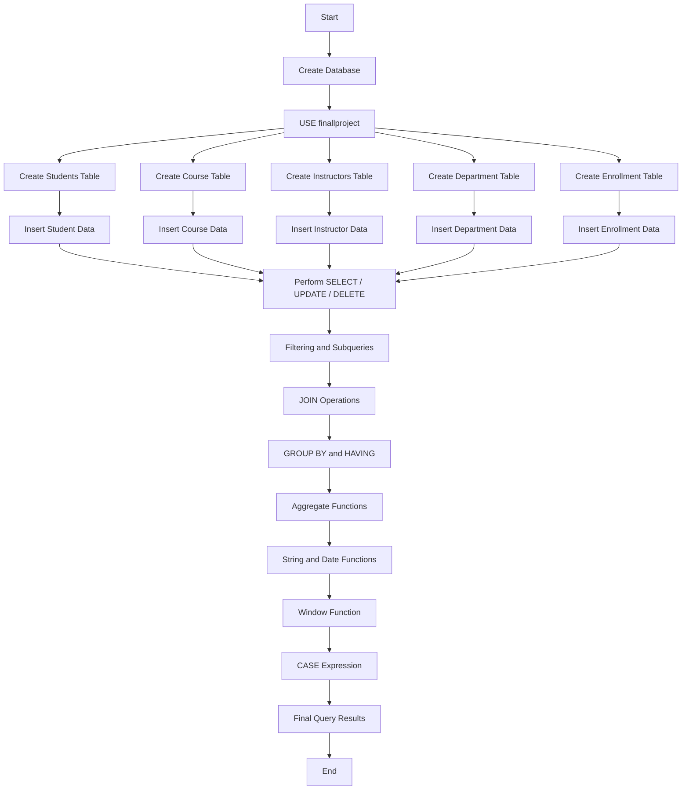

# Final Project – University Database Management System

## 📌 Project Overview

This project is a **MySQL-based University Database Management System**.

The database stores information about:

- Students
- Courses
- Instructors
- Departments
- Student enrollments

The SQL file demonstrates important MySQL concepts such as:

- Database and table creation
- Inserting records
- `SELECT`
- `UPDATE`
- `DELETE`
- Subqueries
- `JOIN`
- `LEFT JOIN`
- `GROUP BY`
- `HAVING`
- Aggregate functions such as `COUNT()` and `AVG()`
- `MAX()`
- String functions such as `CONCAT()`
- Date functions such as `YEAR()` and `CURDATE()`
- Window functions such as `SUM() OVER()`
- `CASE` expressions

---

# 📁 Project File

The main SQL file is:

```text
final_project.sql
```

Run this SQL file in **MySQL Workbench**, MySQL Command Line, or another MySQL-compatible environment.

---

# 🏫 Database Name

The project creates a database named:

```sql
finallproject
```

The first commands are:

```sql
CREATE DATABASE finallproject;
USE finallproject;
```

After selecting the database, all tables and queries are executed inside it.

---

# 🔄 Overall Project Flowchart

The following flowchart shows the basic flow of the project.



---

# 🗂️ Database Structure

The project contains **five main tables**:

```text
                    ┌─────────────────┐
                    │   Department    │
                    │─────────────────│
                    │ dept_id         │
                    │ dept_name       │
                    └────────┬────────┘
                             │
              ┌──────────────┼──────────────┐
              │              │              │
              ▼              ▼              ▼
       ┌────────────┐ ┌────────────┐ ┌──────────────┐
       │  Students  │ │   Course   │ │ Instructors  │
       │────────────│ │────────────│ │──────────────│
       │ student_id │ │ course_id  │ │ instructor_id│
       │ first_name │ │ course_name│ │ first_name   │
       │ last_name  │ │ dept_id    │ │ last_name    │
       │ email      │ │ credits    │ │ email        │
       │ birth_date │ └─────┬──────┘ │ dept_id      │
       │ enroll_date│       │        │ salary       │
       │ dept_id    │       │        └──────────────┘
       └─────┬──────┘       │
             │              │
             └───────┬──────┘
                     ▼
             ┌────────────────┐
             │   Enrollment   │
             │────────────────│
             │ enrollment_id  │
             │ student_id     │
             │ course_id      │
             │ enrollment_date│
             └────────────────┘
```

> **Important:** The SQL file defines the columns used for relationships, but it does not explicitly declare `PRIMARY KEY` or `FOREIGN KEY` constraints. The diagram above represents the intended logical relationships based on the column names.

---

# 📋 Tables and Their Purpose

## 1. Students Table

The `students` table stores student information.

```sql
CREATE TABLE students(
    student_id INT,
    first_name VARCHAR(50),
    last_name VARCHAR(50),
    email VARCHAR(50),
    birth_date DATE,
    enrollment_date DATE,
    dept_id INT,
    number_stu INT
);
```

### Columns

| Column | Purpose |
|---|---|
| `student_id` | Student identification number |
| `first_name` | Student's first name |
| `last_name` | Student's last name |
| `email` | Student email |
| `birth_date` | Student birth date |
| `enrollment_date` | Date the student enrolled |
| `dept_id` | Department ID |
| `number_stu` | Student-related numeric value used in later calculations |

---

## 2. Course Table

The `course` table stores course information.

```sql
CREATE TABLE course(
    course_id INT,
    course_name VARCHAR(50),
    dept_id INT,
    credits INT
);
```

### Columns

| Column | Purpose |
|---|---|
| `course_id` | Course identification number |
| `course_name` | Name of the course |
| `dept_id` | Department associated with the course |
| `credits` | Number of course credits |

Example courses in the file:

- Introduction to SQL
- Data Structures

---

## 3. Instructors Table

The `instructors` table stores instructor information.

```sql
CREATE TABLE instructors(
    instructor_id INT,
    first_name VARCHAR(50),
    last_name VARCHAR(50),
    email VARCHAR(50),
    dept_id INT,
    salary DECIMAL(10,2)
);
```

### Columns

| Column | Purpose |
|---|---|
| `instructor_id` | Instructor ID |
| `first_name` | Instructor first name |
| `last_name` | Instructor last name |
| `email` | Instructor email |
| `dept_id` | Instructor department |
| `salary` | Instructor salary |

---

## 4. Department Table

The `department` table stores department information.

```sql
CREATE TABLE department(
    dept_id INT,
    dept_name VARCHAR(50)
);
```

Example departments:

- Computer Science
- Mathematics

---

## 5. Enrollment Table

The `enrollment` table records enrollment information.

```sql
CREATE TABLE enrollment(
    enrollment_id INT,
    student_id INT,
    course_id INT,
    enrollment_date DATE
);
```

### Columns

| Column | Purpose |
|---|---|
| `enrollment_id` | Enrollment record ID |
| `student_id` | Student associated with enrollment |
| `course_id` | Course associated with enrollment |
| `enrollment_date` | Date of enrollment |

---

# 🔗 Logical Relationships

The project logically connects the tables using IDs.

### Department → Students

```text
department.dept_id
        ↓
students.dept_id
```

This tells us which department a student belongs to.

### Department → Course

```text
department.dept_id
        ↓
course.dept_id
```

This tells us which department offers a course.

### Department → Instructors

```text
department.dept_id
        ↓
instructors.dept_id
```

This tells us which department an instructor belongs to.

### Students → Enrollment

```text
students.student_id
        ↓
enrollment.student_id
```

This connects a student with an enrollment record.

### Course → Enrollment

```text
course.course_id
        ↓
enrollment.course_id
```

This connects a course with an enrollment record.

---

# 🧩 SQL Operations Demonstrated

## 1. CREATE DATABASE

Creates the project database.

```sql
CREATE DATABASE finallproject;
```

---

## 2. USE DATABASE

Selects the database for subsequent operations.

```sql
USE finallproject;
```

---

## 3. CREATE TABLE

Creates tables to store project data.

Example:

```sql
CREATE TABLE students(
    student_id INT,
    first_name VARCHAR(50),
    last_name VARCHAR(50)
);
```

---

## 4. INSERT

Adds records into a table.

Example:

```sql
INSERT INTO students
(student_id, first_name, last_name)
VALUES
(1, 'john', 'doe');
```

---

## 5. SELECT

Displays data.

```sql
SELECT * FROM students;
```

---

## 6. UPDATE

Changes existing data.

Example:

```sql
UPDATE students
SET first_name = 'bob'
WHERE student_id = 2;
```

---

## 7. DELETE

Removes a record.

Example:

```sql
DELETE FROM students
WHERE student_id = 2;
```

---

# 📝 Query-by-Query Explanation

The SQL file contains questions from **Q1 to Q16**.

---

## Q1 – Basic Table Operations

Q1 creates the database and five tables and performs basic operations on them.

The operations include:

```text
CREATE DATABASE
       ↓
CREATE TABLE
       ↓
INSERT
       ↓
SELECT
       ↓
UPDATE
       ↓
DELETE
```

The tables created are:

```text
students
course
instructors
department
enrollment
```

Q1 is mainly used to demonstrate **basic CRUD operations**.

### CRUD

| Operation | SQL Command |
|---|---|
| Create | `CREATE`, `INSERT` |
| Read | `SELECT` |
| Update | `UPDATE` |
| Delete | `DELETE` |

---

# Q2 – Filtering Students by Enrollment Date

```sql
SELECT student_id
FROM students
WHERE enrollment_date > '2022-12-12';
```

### What it does

It returns the `student_id` of students whose enrollment date is after:

```text
2022-12-12
```

### Main concept

```text
WHERE condition
```

---

# Q3 – Find Courses from the Mathematics Department

The SQL file provides two approaches.

### Approach 1: Subquery

```sql
SELECT dept_id, course_name
FROM course
WHERE dept_id IN
(
    SELECT dept_id
    FROM department
    WHERE dept_name = 'mathematics'
)
LIMIT 5;
```

### Approach 2: INNER JOIN

```sql
SELECT c.dept_id, c.course_name
FROM course AS c
INNER JOIN department AS d
ON c.dept_id = d.dept_id
WHERE d.dept_name = 'mathematics'
LIMIT 5;
```

### Main concepts

- Subquery
- `IN`
- `INNER JOIN`
- `LIMIT`

The second version is often easier to understand because it directly connects the course and department tables.

---

# Q4 – Count Students and Use HAVING

```sql
SELECT COUNT(student_id), course_name
FROM students
JOIN course
GROUP BY course_name
HAVING COUNT(student_id) > 5;
```

### Intended concept

The query demonstrates:

```text
COUNT()
   ↓
GROUP BY
   ↓
HAVING
```

`HAVING` is used to filter grouped results.

### Important note

As written in the SQL file, the `JOIN` does not contain an `ON` condition. Depending on the MySQL version/query interpretation, this can produce a Cartesian-style result or may not represent the intended student-course relationship.

---

# Q5 – Course Name Condition

```sql
SELECT student_id
FROM students
JOIN course
WHERE course_name = 'introduction to sql'
AND course_name = 'data structures';
```

### Intended concept

The query demonstrates filtering with `AND`.

### Important note

A single `course_name` value cannot normally be both:

```text
introduction to sql
AND
data structures
```

at the same time.

Therefore, this condition will normally return no rows.

If the intention is to find either course, `OR` would be more appropriate:

```sql
WHERE course_name = 'introduction to sql'
   OR course_name = 'data structures';
```

---

# Q6 – Find Students Associated with Either Course

```sql
SELECT s.student_id
FROM students AS s
INNER JOIN course AS c
ON c.dept_id = s.dept_id
WHERE course_name = 'introduction to sql'
   OR course_name = 'data structures';
```

### What it demonstrates

- Table aliases
- `INNER JOIN`
- `OR`
- Matching department IDs

The query matches students and courses through:

```text
students.dept_id = course.dept_id
```

---

# Q7 – Average Course Credits

```sql
SELECT AVG(credits) AS avg_credit, course_name
FROM course
GROUP BY course_name;
```

### What it does

It calculates the average credit value for each course name.

### Main concept

```text
AVG()
GROUP BY
Alias using AS
```

Example result structure:

| avg_credit | course_name |
|---:|---|
| 3 | introduction to sql |
| 4 | data structures |

---

# Q8 – Instructor Information and Highest Salary

First, all instructors are displayed:

```sql
SELECT * FROM instructors;
```

Then the query finds the instructor with the maximum salary among instructors whose department is Computer Science.

```sql
SELECT instructor_id, dept_id
FROM instructors
WHERE salary =
(
    SELECT MAX(salary)
    FROM instructors
    WHERE dept_id IN
    (
        SELECT dept_id
        FROM department
        WHERE dept_name = 'computer_science'
    )
);
```

### Query flow

```text
Find Computer Science department
          ↓
Get its dept_id
          ↓
Find instructors in that department
          ↓
Find MAX(salary)
          ↓
Return matching instructor
```

### Main concepts

- Nested subquery
- `MAX()`
- `IN`
- `WHERE`

---

# Q9 – Count Students by Department

```sql
SELECT COUNT(student_id), dept_id
FROM students
GROUP BY dept_id;
```

### What it does

Counts students in each department.

### Example structure

```text
Department 1 → Number of students
Department 2 → Number of students
```

### Main concepts

- `COUNT()`
- `GROUP BY`

---

# Q10 – INNER JOIN

```sql
SELECT student_id, course_name
FROM students AS s
INNER JOIN course AS c
ON s.student_id = c.dept_id;
```

### What it demonstrates

An `INNER JOIN` returns matching rows between two tables according to the join condition.

Here the SQL file uses:

```sql
s.student_id = c.dept_id
```

> **Important:** This join condition is unusual for a student-course relationship. A more natural relationship would normally use `enrollment.student_id` and `enrollment.course_id`. The README does not silently change the original query.

---

# Q11 – LEFT JOIN

```sql
SELECT student_id, course_name
FROM students AS s
LEFT JOIN course AS c
ON s.student_id = c.dept_id;
```

### What LEFT JOIN means

A `LEFT JOIN` keeps all rows from the left table (`students`), even if there is no matching row in the right table.

```text
Students
   │
   ├── Matching Course → Show both
   │
   └── No Course → Student can still appear
```

> **Important:** The original SQL uses `s.student_id = c.dept_id` as its join condition. This may not represent the intended student-course relationship.

---

# Q12 – Nested Subqueries

```sql
SELECT student_id
FROM students
WHERE dept_id IN
(
    SELECT dept_id
    FROM course
    WHERE course_id IN
    (
        SELECT course_id
        FROM course
        GROUP BY course_id
        HAVING COUNT(student_id) > 10
    )
);
```

### Query flow

```text
Students
   ↓
Find matching departments
   ↓
Find courses in those departments
   ↓
Group courses
   ↓
Keep courses with COUNT(student_id) > 10
```

### Main concepts

- Nested subqueries
- `IN`
- `GROUP BY`
- `HAVING`
- `COUNT()`

> **Important:** The SQL file counts `student_id` from the `course` table. Since `course` does not define a `student_id` column, this query may produce an error. The enrollment table would normally be involved when counting students enrolled in courses.

---

# Q13 – Extract Enrollment Year

```sql
SELECT s.student_id,
       YEAR(e.enrollment_date) AS year
FROM students AS s
JOIN enrollment AS e;
```

### What it demonstrates

The `YEAR()` function extracts the year from a date.

Example:

```text
2022-08-01 → 2022
```

### Main concept

```sql
YEAR(date_column)
```

> **Important:** The `JOIN` in the original query does not specify an `ON` condition. A proper relationship would normally connect `students.student_id` with `enrollment.student_id`.

---

# Q14 – CONCAT Function

```sql
SELECT CONCAT(first_name, ' ', last_name) AS full_name
FROM instructors;
```

### What it does

Combines first name and last name.

Example:

```text
alice + johnson
       ↓
alice johnson
```

### Main concept

```sql
CONCAT()
```

---

# Q15 – Running Total with Window Function

```sql
SELECT student_id,
       course_id,
       number_stu,
       SUM(number_stu)
       OVER(ORDER BY student_id ASC) AS running_total
FROM students
JOIN course;
```

### What is a running total?

A running total continuously adds the current value to the previous total.

Example:

```text
Student 1 → 1
Student 2 → 1 + 2 = 3
Student 3 → 3 + 3 = 6
```

### Main concept

```sql
SUM(...) OVER(ORDER BY ...)
```

This is called a **window function**.

> **Important:** The original query again uses `JOIN` without an `ON` condition. Also, `course_id` comes from the course table while `number_stu` comes from students. The intended relationship should be reviewed if this query is expected to produce a meaningful student-course running total.

---

# Q16 – CASE Expression and Student Label

```sql
SELECT s.student_id,
       e.enrollment_date,
       CASE
           WHEN (YEAR(CURDATE()) - YEAR(e.enrollment_date)) > 4
           THEN 'senior'
           ELSE 'junior'
       END AS label
FROM enrollment AS e
JOIN students AS s;
```

### What it does

The query calculates the difference between the current year and the enrollment year.

Then it assigns a label:

```text
Difference > 4
      ↓
   senior

Otherwise
      ↓
   junior
```

### Main concepts

- `CASE`
- `WHEN`
- `THEN`
- `ELSE`
- `END`
- `YEAR()`
- `CURDATE()`

> **Important:** The original `JOIN` does not specify an `ON` condition. Normally, `students.student_id = enrollment.student_id` would be used to connect the two tables.

---

# 🧠 Important SQL Concepts Used in This Project

## SELECT

Used to retrieve data.

```sql
SELECT column_name
FROM table_name;
```

---

## WHERE

Used to filter individual rows.

```sql
WHERE salary > 50000;
```

---

## GROUP BY

Groups rows with the same value.

```sql
GROUP BY dept_id;
```

---

## HAVING

Filters groups after `GROUP BY`.

```sql
HAVING COUNT(student_id) > 5;
```

### Easy difference

```text
WHERE  → filters rows
HAVING → filters groups
```

---

## INNER JOIN

Returns matching rows from both tables.

```sql
SELECT *
FROM students s
INNER JOIN course c
ON s.dept_id = c.dept_id;
```

---

## LEFT JOIN

Returns all rows from the left table and matching rows from the right table.

```sql
SELECT *
FROM students s
LEFT JOIN course c
ON s.dept_id = c.dept_id;
```

---

## Subquery

A query inside another query.

```sql
SELECT *
FROM instructors
WHERE salary =
(
    SELECT MAX(salary)
    FROM instructors
);
```

---

## Aggregate Functions

The project uses functions such as:

```text
COUNT()
AVG()
MAX()
SUM()
```

### Purpose

| Function | Purpose |
|---|---|
| `COUNT()` | Counts rows/values |
| `AVG()` | Calculates average |
| `MAX()` | Finds maximum |
| `SUM()` | Calculates total |

---

## String Function

```sql
CONCAT(first_name, ' ', last_name)
```

Combines text values.

---

## Date Functions

The project uses:

```sql
YEAR()
CURDATE()
```

### Example

```sql
YEAR('2022-08-01')
```

returns:

```text
2022
```

---

## CASE Expression

Used to create conditional output.

General structure:

```sql
CASE
    WHEN condition THEN result
    ELSE other_result
END
```

---

## Window Function

The project uses:

```sql
SUM(number_stu)
OVER(ORDER BY student_id)
```

This calculates a running total without collapsing the rows like `GROUP BY` does.

---

# 🛠️ How to Run the Project

## Step 1 – Install MySQL

Install MySQL Server and optionally MySQL Workbench.

## Step 2 – Open MySQL Workbench

Create or open a MySQL connection.

## Step 3 – Open the SQL File

Open:

```text
final_project.sql
```

## Step 4 – Execute the Database Creation

Run:

```sql
CREATE DATABASE finallproject;
USE finallproject;
```

## Step 5 – Create and Insert Data

Execute the table creation and `INSERT` statements.

## Step 6 – Run Individual Questions

Run Q2 through Q16 separately to understand each concept.

---

# ▶️ Recommended Execution Order

Follow this order:

```text
1. CREATE DATABASE
       ↓
2. USE DATABASE
       ↓
3. CREATE TABLES
       ↓
4. INSERT DATA
       ↓
5. SELECT DATA
       ↓
6. UPDATE DATA
       ↓
7. DELETE DATA
       ↓
8. Run Q2
       ↓
9. Run Q3
       ↓
10. Run Q4
       ↓
11. Run Q5
       ↓
12. Run Q6
       ↓
13. Run Q7
       ↓
14. Run Q8
       ↓
15. Run Q9
       ↓
16. Run Q10–Q16
       ↓
17. Review Results
```

---

# ⚠️ Important Notes About the Current SQL

This README is based on the SQL that was provided in `final_project.sql`.

Several queries appear to be written for practice and contain conditions that may not represent the intended database relationship.

The main issues to review are:

### 1. Missing JOIN conditions

Some queries use:

```sql
JOIN table_name
```

without:

```sql
ON condition
```

Examples include Q4, Q13, Q15 and Q16.

For related tables, a proper `ON` condition is normally needed.

---

### 2. Q5 uses contradictory conditions

```sql
course_name = 'introduction to sql'
AND course_name = 'data structures'
```

One value cannot normally be both course names simultaneously.

---

### 3. Q10 and Q11 use unusual join columns

The queries match:

```sql
students.student_id = course.dept_id
```

This is probably not the intended logical relationship.

---

### 4. Q12 references `student_id` from `course`

The `course` table in the SQL file does not contain a `student_id` column.

---

### 5. No explicit primary/foreign keys

The tables contain ID columns, but the SQL does not define them as:

```sql
PRIMARY KEY
```

or:

```sql
FOREIGN KEY
```

Therefore, the relationships are logical rather than enforced by MySQL constraints.

---

# 📚 Project Learning Outcomes

After completing this project, you should understand:

- How to create a MySQL database
- How to create tables
- How to insert data
- How to retrieve data
- How to update records
- How to delete records
- How to filter records
- How to use aggregate functions
- How to group data
- How to filter grouped data
- How to use subqueries
- How to use joins
- How to use string functions
- How to use date functions
- How to use `CASE`
- How to use window functions
- How multiple database tables can work together

---

# 🧾 Quick Concept Map

```text
                    MYSQL UNIVERSITY PROJECT
                              │
        ┌─────────────────────┼─────────────────────┐
        │                     │                     │
     DATABASE              TABLES               QUERIES
        │                     │                     │
   finallproject       ┌──────┼──────┐              │
                       │      │      │              │
                   Students Course Department       │
                       │      │      │              │
                   Instructors Enrollment           │
                                                    │
                         ┌──────────────────────────┼───────────────┐
                         │                          │               │
                       CRUD                     JOINS          SUBQUERIES
                         │                          │               │
                 SELECT/INSERT              INNER/LEFT          IN/SELECT
                 UPDATE/DELETE                                   │
                         │                                      MAX
                         │
                   AGGREGATION
                         │
             COUNT / AVG / MAX / SUM
                         │
                  GROUP BY / HAVING
                         │
                  ┌──────┴─────────┐
                  │                │
             DATE FUNCTIONS     STRING FUNCTIONS
             YEAR/CURDATE          CONCAT
                  │
                  └─────────┬──────┘
                            │
                       ADVANCED SQL
                            │
                  CASE + WINDOW FUNCTION
```

---

# 👩‍💻 Author / Project Information

**Project:** University Database Management System

**Database:** MySQL

**Database Name:** `finallproject`

**Main SQL File:** `final_project.sql`

---

# ✅ Final Summary

This project is a practical demonstration of MySQL database operations using a university-management scenario.

The project starts by creating the database and tables, adds sample data, performs CRUD operations, and then demonstrates increasingly advanced SQL concepts.

The overall learning path is:

```text
Database Creation
       ↓
Table Creation
       ↓
Data Insertion
       ↓
CRUD Operations
       ↓
Filtering
       ↓
Joins
       ↓
Subqueries
       ↓
Grouping & Aggregation
       ↓
Date & String Functions
       ↓
Window Functions
       ↓
CASE Expressions
       ↓
Final Results
```

This makes the project useful as a **MySQL practice project, college assignment, viva preparation, and SQL revision reference**.
